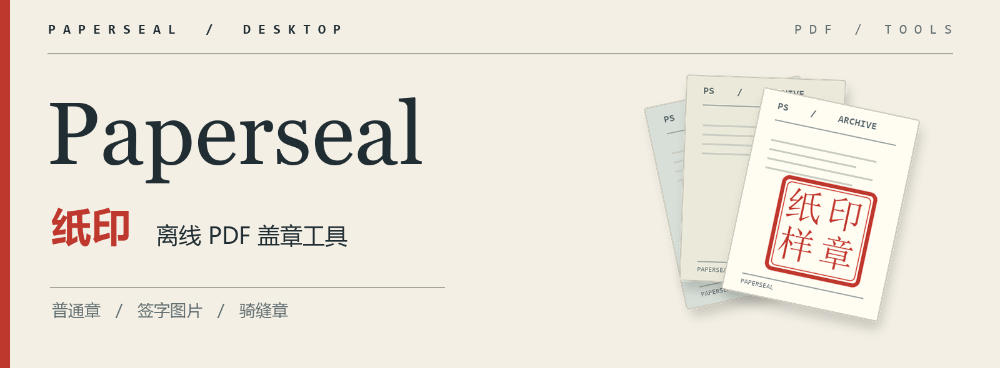
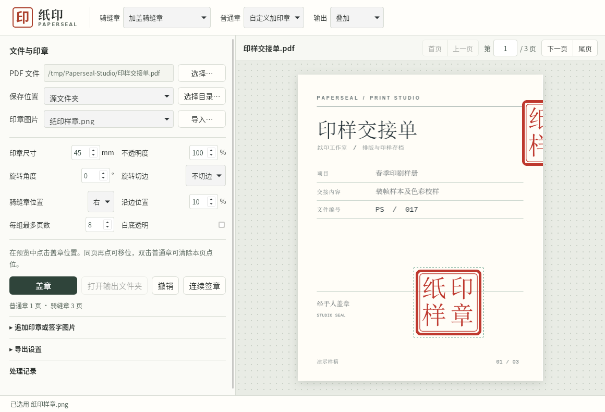
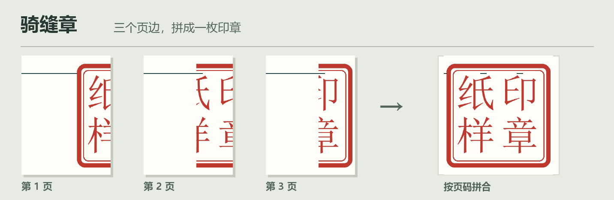

# 纸印 Paperseal

给一份多页 PDF 盖骑缝章，在签章页点一下放上完整印章，再存成一份新 PDF。文件、印章和签字图片都留在自己的电脑上。

[下载最新版](https://github.com/KevinLADLee/paperseal/releases/latest) · [第一次盖章](#第一次盖章) · [从源码运行](#从源码运行) · [反馈问题](https://github.com/KevinLADLee/paperseal/issues)

## 第一次盖章

1. 打开纸印，选择一份 PDF。保存位置默认是「源文件夹」。
2. 在「印章图片」旁点「导入…」，选择一张已裁去多余空白的 PNG 或 JPEG，填入章名和实物宽度（圆章填直径，单位为毫米）。以后选这枚章就会沿用登记尺寸。旧版已缓存的章首次选用时补填即可。
3. 保留默认的「加盖骑缝章」和「自定义加印章」，翻到签章页，点击预览中的落章位置。同一页再点一次就能调整位置。签章栏较小时，可在预览上方选「适合宽度」或放大后再定位。
4. 点「盖章」，再点「打开输出文件夹」查看副本。源文件会保留，同名副本会自动编号。



## 骑缝章怎样跨页

下面是同一份三页样稿导出后的右页边。按页码把三段红印拼在一起，就能读出完整的「纸印样章」。



骑缝章至少需要两页。可选上、下、左、右任一页边，拖动或输入百分比调整位置。默认每枚章最多跨 8 个参与页。例如 15 页会分成 **1–8 页**和 **8–15 页**，第 8 页同时保留前后两枚章的切片。

## 印章与导出

| 想做什么 | 在哪里设置 |
| --- | --- |
| 同页盖多枚章，或连续在多页落章 | 打开「连续签章」，每点一次放一枚，按 Esc 结束。 |
| 追加手写签名，只放在指定页 | 展开「追加印章或签字图片」，选中标记后打开「页码与外观」，可输入 `1,3-6,9`。 |
| 换另一枚章 | 在下拉框选章后点预览追加。已放置的章保留原印样和尺寸。需要同时更换自动普通章和骑缝章时，点「替换本合同主章」。 |
| 校准印章尺寸 | 点「管理当前印章…」修改实物宽度。普通章、骑缝章和连续签章都使用登记尺寸。 |
| 保留原有可搜索文字 | 使用默认的「叠加」输出。 |
| 导出整页图像 | 选择「合并为图片」，可设 72、150、300 或 600 DPI。此模式会移除原文字层、链接与交互表单。 |
| 给副本设密码 | 在「导出设置」中沿用源文件保护、取消加密或设置新的 AES-256 打开密码。 |

签字图片只呈现手写签名的外观。已有数字签名的 PDF 经修改后，原签名的验证结果可能改变。

## 下载安装

从 [GitHub Releases](https://github.com/KevinLADLee/paperseal/releases/latest) 选择与你的系统匹配的文件，也可以使用下表直接下载 v0.3.3。

| 系统 | 下载 v0.3.3 | 启动方式 |
| --- | --- | --- |
| Windows 11 x64 | [便携版 EXE](https://github.com/KevinLADLee/paperseal/releases/download/v0.3.3/Paperseal-Windows-11-x64.exe) | 双击运行，需要 Microsoft Edge WebView2 运行时。 |
| Ubuntu 22.04 x86-64 | [AppImage 压缩包](https://github.com/KevinLADLee/paperseal/releases/download/v0.3.3/Paperseal-Ubuntu-22.04-x86_64.tar.gz) | 解开 `.tar.gz`，运行其中的 AppImage。 |
| Ubuntu 24.04 x86-64 | [AppImage 压缩包](https://github.com/KevinLADLee/paperseal/releases/download/v0.3.3/Paperseal-Ubuntu-24.04-x86_64.tar.gz) | 解开 `.tar.gz`，运行其中的 AppImage。 |

Ubuntu 缺少 FUSE 2 时，可在解压目录运行以下命令，24.04 用户将文件名中的版本替换为 `24.04`。

```sh
APPIMAGE_EXTRACT_AND_RUN=1 ./Paperseal-Ubuntu-22.04-x86_64.AppImage
```

## 从源码运行

Ubuntu 以 22.04 x86-64 为构建基线。准备稳定版 Rust 和 Python 3，然后在仓库根目录运行下列命令。

```sh
sudo apt update
sudo apt install build-essential pkg-config libssl-dev libgtk-3-dev libwebkit2gtk-4.1-dev libayatana-appindicator3-dev librsvg2-dev
python3 tools/prepare.py
cargo run --locked -p pdf-seal
```

`prepare.py` 首次下载固定版本的 PDF.js 并校验 SHA-512，之后复用缓存。修改 `ui/` 后重新运行该脚本。开发时可用下列命令测试盖章布局及 PDF 导出，并生成本机的 Debian 安装包。

```sh
cargo test --locked -p seal-core
cargo build --locked --release -p pdf-seal
bash tools/package-deb.sh
```

Windows 使用稳定版 Rust 的 MSVC 工具链、Visual Studio C++ Build Tools、Windows SDK、Python 3 和 WebView2。在仓库根目录运行以下命令，默认产物为 `target/release/pdf-seal.exe`。

```powershell
python tools/prepare.py
cargo build --locked --release -p pdf-seal
```

[core/](core/) 包含骑缝分组、坐标换算与 PDF 导出，[desktop/](desktop/) 负责 Tauri 窗口和本地文件操作，[ui/](ui/) 提供 PDF.js 预览与印章交互。[导出测试](core/tests/export.rs) 覆盖分组交接页、旋转和裁剪后的页面等边界情况。
